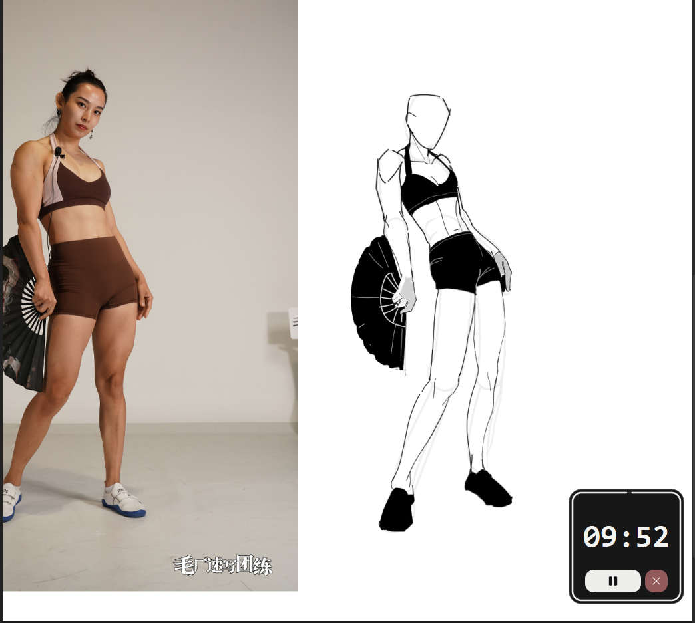

# ClenTimer

A small, always-on-top countdown timer for Windows. The frameless bar folds into a square when you start a timer. A white ring shows the remaining time.



## Download

Get the installer or portable ZIP from the [latest release](https://github.com/RyuuMeow/ClenTimer/releases/latest). For the portable edition, extract the whole folder somewhere writable and run **ClenTimer.exe**. It saves your last duration in **ClenTimer.ini** beside the executable.

## Controls

- Type **0.5 or 1–99 minutes**, or hover over the number and scroll one minute at a time. The arrows adjust by 1, 5 or 10 minutes at the 10- and 30-minute thresholds.
- Press **Enter** or click **Play** to start. Pause and resume with the main button, or click the red **×** to cancel.
- Toggle the square repeat button before starting to run consecutive rounds. White means repeat is on. After three chimes the next round starts automatically.
- With repeat off, at zero, the digits blink red and a short chime plays three times. Click the **checkmark** to return to setup.
- Drag the background to move the timer.

## Build on Windows

Use Visual Studio 2022 with Desktop development with C++, CMake 3.21+, and an MSVC x64 build of Qt 6 (built with Qt 6.9.0). In PowerShell:

```powershell
cmake -S . -B build -G "Visual Studio 17 2022" -A x64 "-DCMAKE_PREFIX_PATH=C:/Qt/6.9.0/msvc2022_64"
cmake --build build --config Release
```

To package both downloads manually, install Inno Setup 6 and run the following after building:

```powershell
.\packaging\package.ps1 -QtDir C:\Qt\6.9.0\msvc2022_64
```

Icons by [Phosphor](https://phosphoricons.com/). Completion sound from [Kenney Interface Sounds](https://kenney.nl/assets/interface-sounds).
